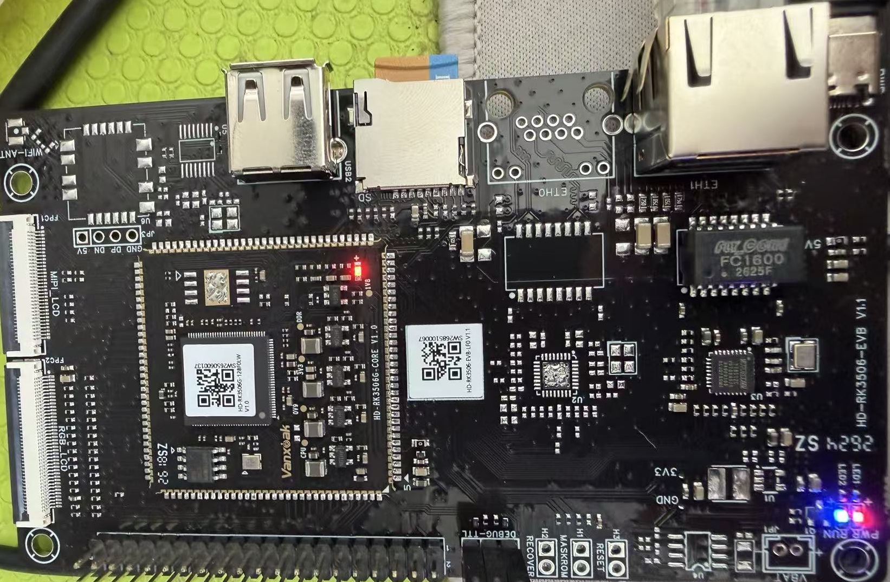

# rk3506-mini Software Repository

Development repository for the Vanxoak HD-RK3506G-CORE / HD-RK3506-EVB
mini board (Rockchip RK3506G: 3x Cortex-A7 + Cortex-M0, no on-board flash -
boots from TF card, Buildroot Linux).

Board OS: vendor Buildroot image, kernel `6.1.118`
(`/etc/os-release`: `linux-6.1-stan-rkr4.3`), ~98 MB RAM, 3 A7 cores visible
to Linux, TF-card rootfs. The Cortex-M0 is used by the vendor AMP/RT-Thread
firmware (not exercised by this repo yet).



## Board connection (verified working)

Ethernet on ETH1 (YT8512C PHY). **Single DHCP address** (fixed): the stock
image ran two DHCP clients at once - `udhcpc` (ifupdown) and `dhcpcd`
(S41dhcpcd) - so the router handed out two leases and eth1 carried two
addresses with confusing drift across reboots. Fix applied on the board
rootfs (persists): `chmod -x /etc/init.d/S41dhcpcd` (udhcpc remains, with
the `eth1_static` fallback 192.168.5.211 still available if DHCP fails).
The address can still change between boots - if unreachable, rescan with
`tools/find_board.sh 192.168.5`.

- WSL: `~/.ssh/config` has a `rk3506-buildroot` Host alias pointing at the
  current IP; login `root` / password `root`, plus the host key of this
  machine installed in `/root/.ssh/authorized_keys` (passwordless).
  If the board becomes unreachable, run `tools/find_board.sh` (rescans the
  /24, identifies the board by hostname and rewrites the alias).
- Windows: add the same IP to `C:\Windows\System32\drivers\etc\hosts` as
  `rk3506-buildroot` to use plain `ssh rk3506-buildroot` there (currently
  **not** done - WSL is the development environment).
- Serial: DEBUG-TTL header, 115200 8N1 (COM7 on this PC) - rescue access
  when the network is gone.
- USB1 (Type-C) supports adb (`adb_login.pdf` in the vendor folder) and
  USB flashing via RKDevTool / DriverAssistant (also in the vendor folder).

Vendor docs (PDFs, schematics, SDKs) live in
`D:\board_database\rk3506-mini` and are **not** part of this repo
(see `docs/README.md`).

## Toolchain (verified end-to-end)

Buildroot external SDK exported by the vendor:
`arm-buildroot-linux-gnueabihf_sdk-buildroot-20260326.tar.gz`
(GCC 12.4.0, glibc, armv7-a NEON-VFPV4 hard-float; sysroot contains the
board's userspace libraries: liblvgl, librkadk, librockit, librga, libdrm,
libgpiod, GStreamer, freetype, ...).

Installed in WSL at `~/toolchains/arm-buildroot-linux-gnueabihf_sdk-buildroot`
(extract + `./relocate-sdk.sh`, done). Source `env.sh` in the repo root to
put it on PATH. A verified CMake setup (toolchain file) was used to prove
the flow before the repo switched to per-project Makefiles:

```
cmake -DCMAKE_TOOLCHAIN_FILE=toolchain.cmake -B build -S . && cmake --build build
```

Cross build + fast deploy loop (from `app/<project>/`):

```
make push run
```

**Gotcha - linking vendor shared libs:** `/usr/lib/liblvgl.so` on the board
is *not* self-contained; any app linking it must link the whole closure the
vendor demo uses (see `app/lvgl_demo/CMakeLists.txt` in the SDK):
`-llvgl -lfreetype -ldrm -levdev -lrockit -lrkadk -lrga -lpthread -lm`.
Plain POSIX apps (all projects in this repo so far) need nothing special.

Debugging: no cross-gdb in the SDK, no gdbserver on the target - printf
debugging it is. (Could be added later by enabling `BR2_PACKAGE_GDB` and
rebuilding the rootfs with the full SDK.)

## Applications

| App | What it drives | Notes |
|---|---|---|
| `app/hello` | - | toolchain smoke test |
| `app/blink_hello` | LED2 (heartbeat) + SoC temp | LED class API, restores trigger on exit |
| `app/coremark` / `app/coremark_cm0` | - | CPU benchmark (3x A7 @ 1.2 GHz, fixed clock - see `docs/cpu_clock_dvfs.md`) |
| `app/ssd1317_md066_64x48_iic` | SSD1317 OLED 64x48 on I2C | stock boot logo + scaled stock fonts |
| `app/ili9163c_md144_128x128_spi` | ILI9163C 1.44" 128x128, 3-wire 9-bit SPI | 60 fps @ hw SPI0; boot logo screen |
| `app/st7789_md169_240x280_spi` | ST7789 1.69" 240x280, 4-wire SPI mode 0 | 22 fps full-frame; PWM backlight |
| `app/st7789_md130_240x240` | ST7789 1.3" 240x240, 4-wire SPI **mode 3** | CS hardwired to GND on module |
| `app/gpio_test` | JP4 pins | RM_IO iomux diagnostic walker |

All LCD apps share the same demo flow (banner -> info -> inverted info
-> TEST_STAND with dwell -> HSV gradient -> stock boot logo -> scaled
fonts, fps counter, 11%/55% alternating backlight loops) and run on the
**rebuilt-DTB image** (hardware SPI0 + PWM on JP4). How that image was
produced and how the SPI transport works:
**`docs/spi_howto.md`** (start there), `docs/jp4_spi_lcm.md` (pin
budget + no-rebuild bit-bang fallback), `docs/graphics_stack_notes.md`
(stock display chain).

## On-board LEDs

| LED | GPIO | Kernel LED name | Default role |
|---|---|---|---|
| LED1 | - | - | 3.3 V power indicator (hardwired) |
| LED2 | GPIO0_D0 (= gpio 24) | `run` (`/sys/class/leds/run`) | `heartbeat` trigger |

Control: `echo none > /sys/class/leds/run/trigger` then
`echo 1|0 > /sys/class/leds/run/brightness`. Everything is root-owned
mode 644; the board is used as root, so no permission issues.

**Note (verified):** the kernel DT marks the LED **ACTIVE LOW** -
`/sys/kernel/debug/gpio` shows `gpio-24 ... out lo ACTIVE LOW`, i.e. writing
`brightness=1` drives the physical pin low to light the LED. The vendor
README claims "high active" - that refers to the raw pin, not the LED class
API. Use the LED class API and polarity never matters.

Stealing the heartbeat is harmless: the trigger is purely cosmetic, no
system code depends on it, and after a reboot the heartbeat comes back.
`app/blink_hello` restores the previous trigger on exit anyway.

## SoC temperature (verified)

`/sys/class/thermal/thermal_zone0/temp` (millidegrees C, read-only),
~45 C idle. `app/blink_hello` samples it every blink.

This is the chip's **internal TSADC die sensor** (`tsadc@ff650000`,
`soc-thermal`), trimmed via OTP, with hardware shutdown configured at
120 C. No external temperature sensor is involved.

## ADC (verified)

Two separate ADC blocks:

1. **TSADC** - die temperature only (above), not usable for external
   signals.
2. **SARADC** (`adc@ff4e8000`, exposed as `/sys/bus/iio/devices/iio:device0`,
   8 channels `in_voltage0_raw`..`in_voltage7_raw`, 10-bit, VREF = 1.8 V,
   scale 1.7578125 mV/LSB).

But on **this** board the SARADC is not usable for general purposes - the
schematic shows:

| Channel | Bonded pin | Baseboard wiring | Idle reading |
|---|---|---|---|
| IN0 | `SARADC_IN0_BOOT` | MASKROM jumper H1 (short to GND = maskrom mode) | ~1.79 V |
| IN1 | `SARADC_IN1_RECOVER` | RECOVER jumper H2 (short to GND = loader mode) | ~1.79 V |
| IN2 | `SARADC_IN2` | **unconnected** (no connector/test point) | ~0.9 V float |
| IN3 | `SARADC_IN3` | **unconnected** | ~0.9 V float |
| IN4..IN7 | not bonded | - | 0 |

JP4 (40-pin expansion) carries **no ADC signals**. So: analog inputs on
this board = 2 key/jumper channels + 2 floating channels not routed
anywhere. To use a real external analog signal, add an external I2C/SPI
ADC (JP4 has I2C0/I2C1 and SPI0).

(The internal audio codec also has differential mic inputs
`ACODEC_ADC_INP/INN`, also unconnected on this board.)

## Serial console

DEBUG-TTL 3-pin: TXD / RXD / GND, 115200 8N1.

## Vendor SDK notes

- `rk3506_linux6.1_sdk_v1.2.0_evb` (in `D:\board_database\rk3506-mini`) is
  the full build system (kernel/U-Boot/Buildroot/app demos). Only needed to
  rebuild system images; the board defconfigs are
  `rockchip_hd_rk3506g_evb_sd_defconfig` (this board) and a `_nand` variant.
  Best user-space reference inside it: `app/lvgl_demo` (LVGL 8/9 on DRM +
  rkadk) and `docs/cn|en` (Rockchip documentation).
- The 40 GB "all source SDK" was **not** downloaded - not needed for
  application development.
- The toolchain tarball was exported from the vendor's `nand` variant
  buildroot output (original path visible in `relocate-sdk.sh` before
  relocation), but the ABI is identical to the SD image - binaries verified
  running on the board.

## References

- `docs/spi_howto.md` - hardware SPI on JP4, as-built (DTB + kernel
  fragment + userspace transport + panel quirks)
- Vendor folder: `D:\board_database\rk3506-mini` (schematics, pin lists,
  datasheet, programming guides - see `docs/README.md`)
- Rockchip RK3506 TRM and SDK docs in the SDK `docs/` tree
